

# IVA DECK

### A custom ESP32 macro keyboard with a desktop companion and behavioral recognition

**9 mechanical keys · 3 volume controls · LCD + microSD · USB / Bluetooth · Python + PyQt6**

[Demo](docs/media/iva-deck-demo.mp4) · [Get started](docs/getting-started.md) · [Hardware](docs/hardware.md) · [Protocol](docs/protocol.md) · [AI experiment](docs/behavioral-recognition.md) · [Română](docs/README.ro.md)

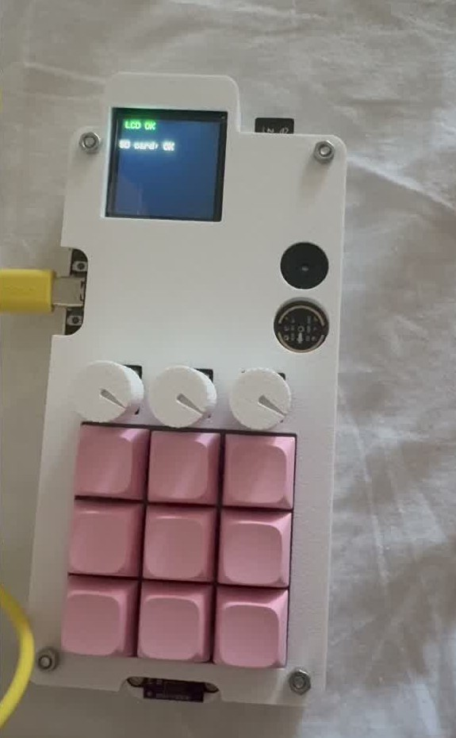

**Designed and built by Ioan-Andrei Ivașcu**

IVA DECK combines a custom PCB, ESP32 electronics, embedded software, a Windows desktop application, and a behavioral recognition experiment. Nine programmable keys handle shortcuts and media actions, three physical knobs control application volume, and the companion app exposes the display, storage, buzzer, and proximity sensor.

The original academic project was presented in June 2025 at the Faculty of Mathematics and Computer Science, University of Bucharest, as **“Tastatură Inteligentă cu Recunoaștere Comportamentală asistată de AI.”**

## See it working

[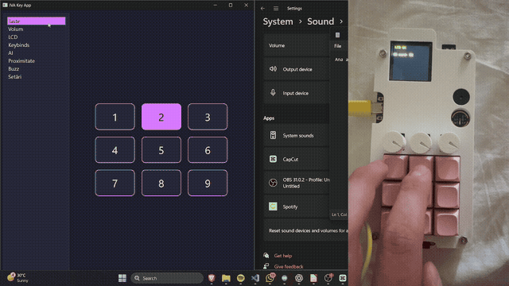](docs/media/iva-deck-demo.mp4)

**[Full demonstration with audio — 2 min 8 sec](docs/media/iva-deck-demo.mp4)**

The recording shows key presses, macro configuration, audio controls, proximity feedback, display interaction, and behavioral analysis. The GIF is a silent excerpt. Open or download the MP4 for the complete recording.

## What I built

| Layer | Contribution |
| --- | --- |
| Hardware | Custom KiCad PCBs, 3×3 key matrix, three potentiometers, peripheral integration, and enclosure |
| Embedded | ESP32 peripheral control and bidirectional serial messaging |
| Desktop | PyQt6 interface for macros, Windows volume control, device commands, and logging |
| AI experiment | Feature extraction and Random Forest recognition using keys, timing, distance, and volume |

## Desktop companion

| Live keys | Application volume |
| --- | --- |
| 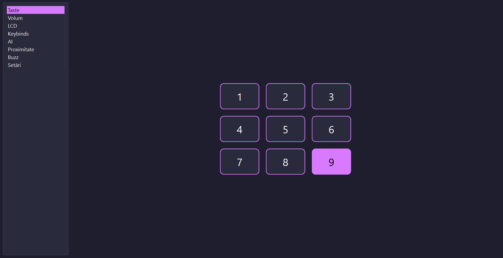 | 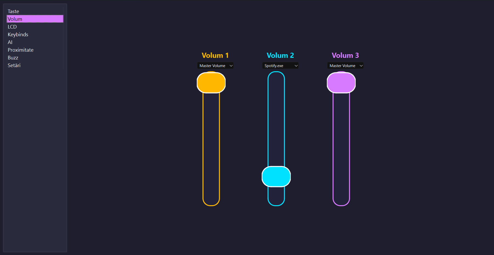 |

| Macros | Display and storage |
| --- | --- |
| 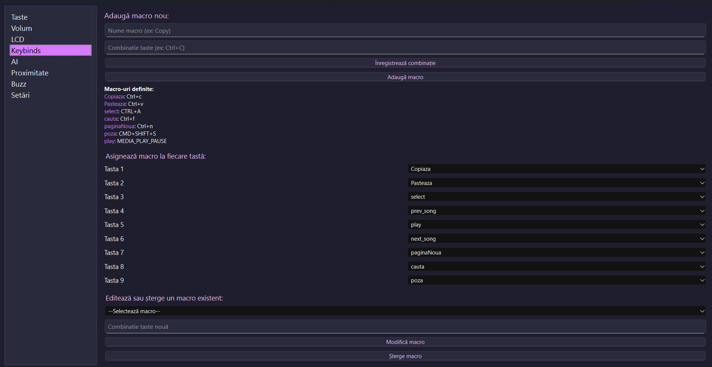 | 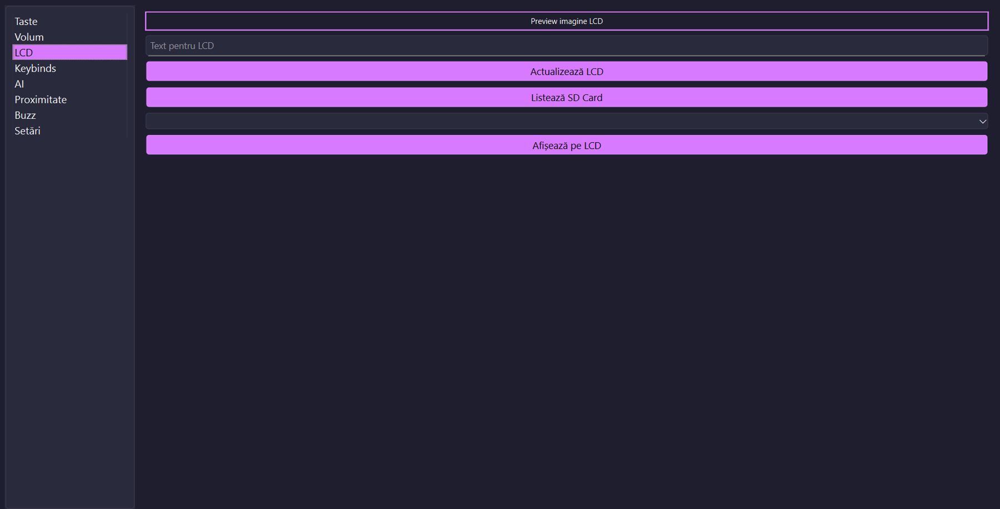 |

The application targets **Windows**, using `pycaw` and Windows COM APIs for audio-session control. Its interface is in Romanian.

More application screens: proximity and connections

| Proximity | Connection settings |
| --- | --- |
| 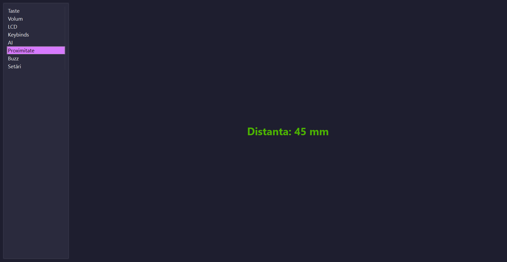 | 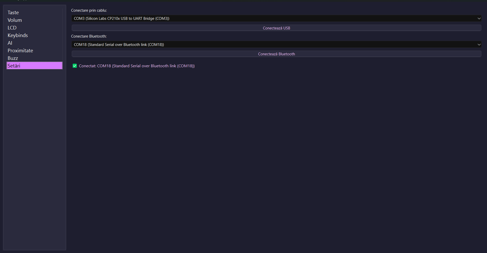 |

## Architecture

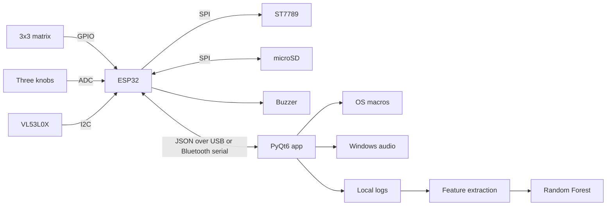

The INMP441 microphone is included in the hardware design. Full host audio streaming and voice control are unfinished, rather than demonstrated features.

## From prototype to PCB

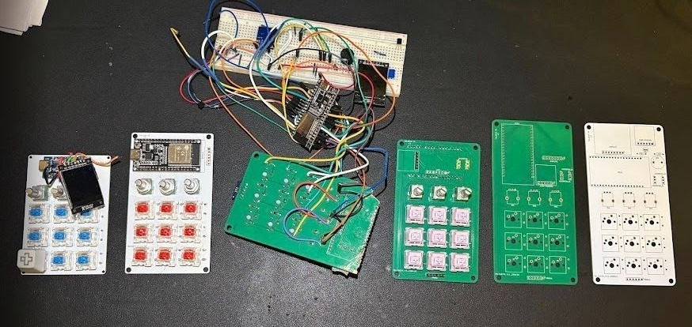

| PCB layout | Enclosure design |
| --- | --- |
| 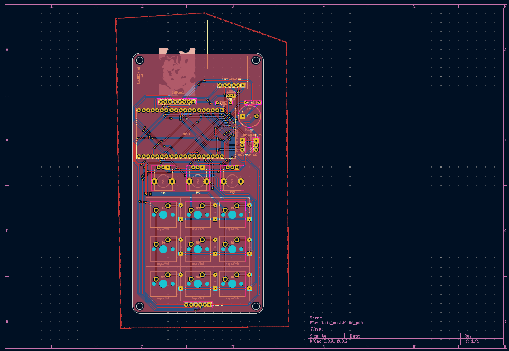 | 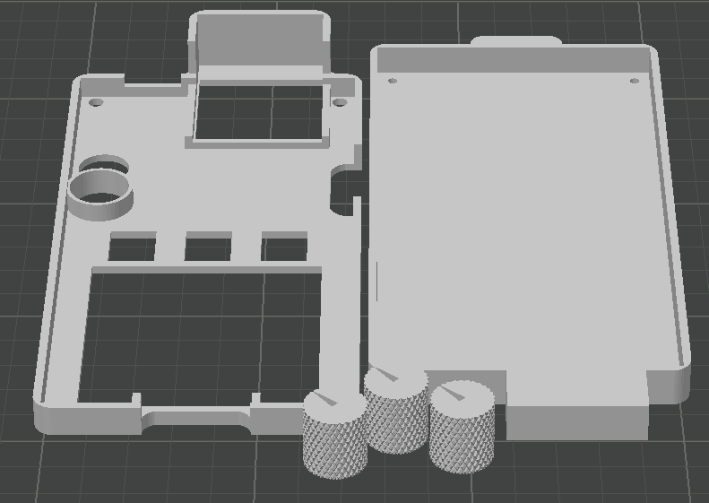 |

Original hardware iterations are preserved. Start with [revision v6](HARDWARE/v6_esp32/) and the [hardware guide](docs/hardware.md).

## Explore

| Material | Contents |
| --- | --- |
| [Getting started](docs/getting-started.md) | Windows installation and connections |
| [Desktop source](SOFTWARE/APP/v4/iva_key_app/) | PyQt6 app and configuration |
| [ESP32 v6](SOFTWARE/DECK/v6_esp32/) | Sketches and firmware status |
| [KiCad hardware](HARDWARE/) | Schematics, layouts, and production exports |
| [Protocol](docs/protocol.md) | Host messages and commands |
| [Behavioral recognition](docs/behavioral-recognition.md) | Training workflow and evaluation limits |
| [Thesis](Documentation.pdf) | Original 52-page Romanian academic documentation |
| [Presentation PDF](docs/presentation-ro.pdf) | Romanian defense presentation |
| [Editable slides](Presentation.pptx) | Original slide deck |

## Project status

The desktop source, AI script, KiCad projects, and peripheral tests are available. A complete **historical ESP32 sketch was recovered from the author's development chat** and is included with provenance and compatibility notes. It has not been verified as the exact firmware used in the demo; see the [firmware status](SOFTWARE/DECK/v6_esp32/README.md).

The thesis reports approximately **70% behavioral recognition** in its experiment. This is a historical reported result, not a newly reproduced benchmark or an authentication guarantee. See the [AI guide](docs/behavioral-recognition.md).

Documentation and media were checked against the supplied materials and repository source. Fresh hardware operation, firmware compilation, and desktop integration have not been revalidated during this documentation update.

## Author

**Ioan-Andrei Ivașcu** · [@AndreiasM5](https://github.com/AndreiasM5)

Custom hardware, firmware development, companion software, and behavioral-recognition research for the original academic project.
