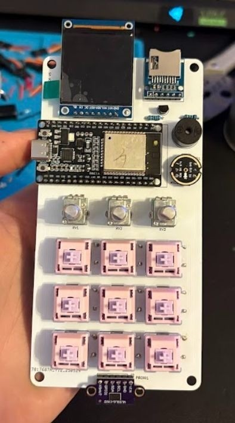
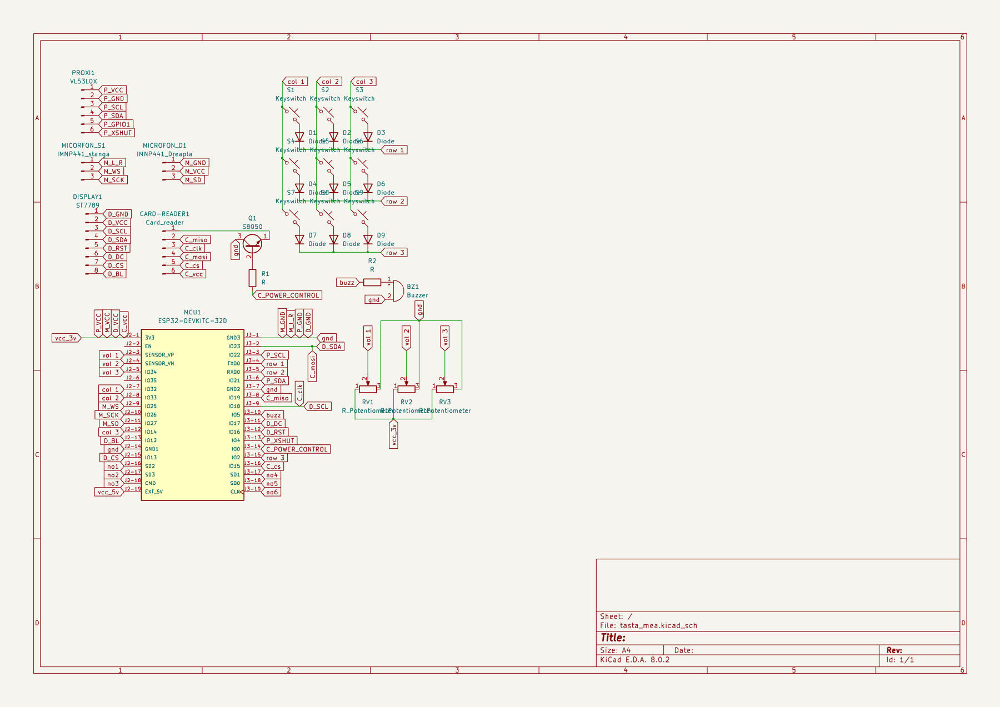

# Hardware

[← Overview](../README.md)

| Component | Interface and role |
| --- | --- |
| ESP32 | Main controller; USB / Bluetooth serial |
| Nine switches | 3×3 GPIO matrix |
| Three potentiometers | ADC audio controls |
| ST7789, 240×240 | SPI display |
| microSD | Image storage, shared SPI |
| VL53L0X | I2C proximity |
| Buzzer | GPIO / PWM feedback |
| INMP441 | I2S hardware provision; full audio path unfinished |

Start with [KiCad revision v6](../HARDWARE/v6_esp32/). Open `tasta_mea.kicad_pro`; the editable schematic and layout use `.kicad_sch` and `.kicad_pcb`. Existing manufacturing files are in `production/`.

Schematic overview

Use editable sources to inspect nets and clearances. Run ERC/DRC and verify manufacturing exports for the selected revision before fabrication. Exports have not been regenerated in this update.

## Pins in the v6 diagnostics

| Peripheral | GPIO |
| --- | --- |
| Matrix rows | 26, 27, 4 |
| Matrix columns | 32, 33, 25 |
| Potentiometers | 36, 39, 34 |
| TFT CS / DC / reset | 21 / 17 / 16 |
| SD chip select | 13 |

These values come from the available test sketches; they are not a complete verified mapping for the integrated firmware. Check the selected schematic and actual board because revisions differ.

### Recovered development-sketch pin map

The recovered 5 June 2025 sketch uses a different mapping:

| Peripheral | GPIO |
| --- | --- |
| Matrix rows / columns | 1, 3, 2 / 14, 33, 32 |
| Potentiometers | 36, 39, 34 |
| TFT CS / DC / reset / backlight | 13 / 17 / 16 / 12 |
| SD CS / power-control signal | 15 / 0 |
| SPI clock / MOSI / MISO | 18 / 23 / 19 |
| VL53L0X SDA / SCL / XSHUT | 21 / 22 / 4 |
| Buzzer | 5 |
| I2S WS / clock / data | 25 / 26 / 27 |

These are source definitions, not freshly verified wiring. The recovered sketch leaves proximity and microphone calls disabled. Read its [status and compatibility notes](../SOFTWARE/DECK/v6_esp32/README.md) before use.

## Design history

Historical directories preserve early Arduino Micro boards and later ESP32 iterations. Their numbering does not imply every intermediate revision is included.

The enclosure image is from the thesis. Editable enclosure CAD/STL is not included in this snapshot.
